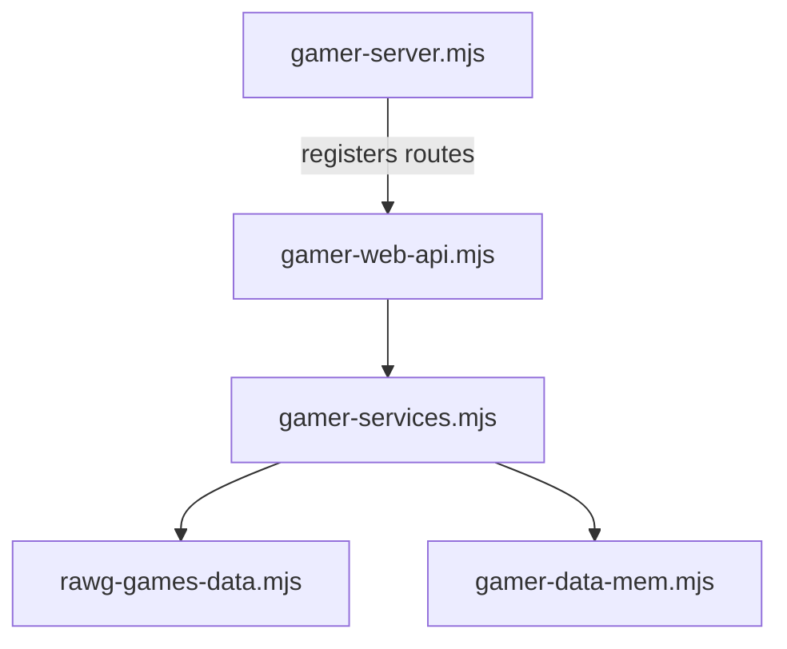
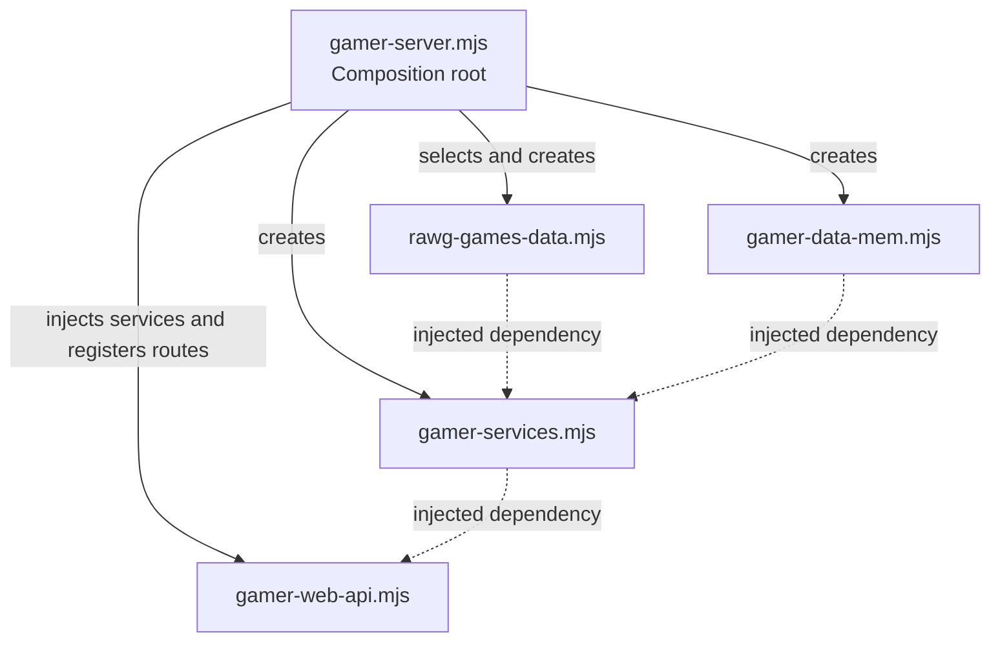
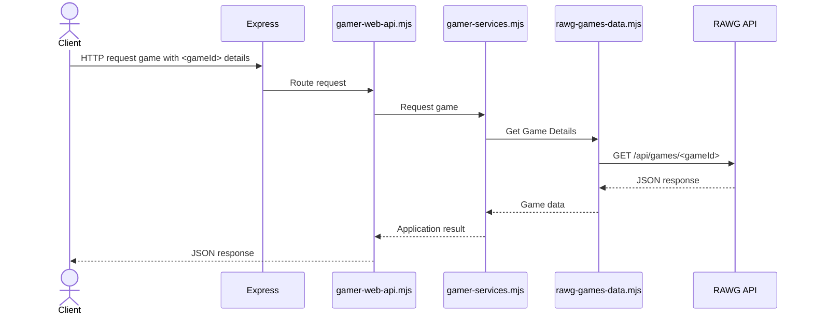

Instituto Superior de Engenharia de Lisboa

Bachelor in Computer Science and Computer Engineering
 Bachelor in Informatics, Networks and Telecommunications Engineering

Web Programming and Architecture
 
Winter Semester of 2026/2027 – <strong>2nd practical assignment - GAMER - Part 1</strong>

---

# Delivery

## **Due date for this assignment:** 23/11/2026 - 23h59.

## **Delivery method**

The delivery method is through GitHub Classroom. Following the invitation link
below, sign in with your GitHub account and select your student ID to associate
it with your account and create or join a group.

**Classroom invitation:** Each class will have its own classroom.

The assignment must be delivered in the repository created by GitHub Classroom,
by creating a tag called `GAMER-P1`. If you need to update your delivery, create
another tag named `GAMER-P1.1`, `GAMER-P1.2`, and so on.

# Introduction

The practical component of this course will be developed around **GAMER**
(**G**ames **A**PI, **M**y **E**ntertainment **R**egistry), a web application
for exploring video games and managing personal game collections. The
application obtains its game catalogue information from the [RAWG Video Games
Database API](https://rawg.io/apidocs).

To access RAWG, each student must obtain an API key by registering with the
service. Requests must include the key in the `key` query parameter. The free
API has usage limits; read and comply with the [RAWG API terms and
limits](https://rawg.io/apidocs).

Development will take place incrementally in three parts (Part 1, Part 2 and
Part 3). Each part has its own delivery deadline, which is a non-negotiable
requirement. The application is expected to evolve through refactoring, so use
good programming practices and keep the modules loosely coupled.

For each GAMER functionality, define the corresponding HTTP endpoint. Document
all application endpoints in an
[OpenAPI](https://github.com/OAI/OpenAPI-Specification) file named
`docs/gamer-api-spec.json` (or `.yaml`). Include REST Client-compatible requests
in `docs/gamer-api-requests.http` to validate the API.

Summary of the artifacts to be submitted:

- OpenAPI specification: `docs/gamer-api-spec.[yaml|json]`

- REST Client requests: `docs/gamer-api-requests.http`

- Node.js GAMER application files

# Functional Requirements

Develop a web application that exposes a REST-style web API. Responses must use
JSON and support the following features:

- List games available from RAWG. Support pagination and, where available in the
  API, filters such as search text, genre, platform and release dates. Return at
  least each game's RAWG identifier, name, release date and background image
  URL.

- Get the details of a game by its RAWG identifier. Return its name,
  description, release date, platforms, genres, developers, publishers, rating
  and website when available.

- Create a user, given a username. Generate a UUID token using
  `crypto.randomUUID()` and return it to the user.

- Manage personal **Game Lists**. Each list has a name and description and
  belongs to the authenticated user:

  - Create a list.

  - Edit a list's name and description.

  - List the authenticated user's lists.

  - Get a list's details, including its name, description and selected games.
    Each game entry must contain its `gameId`, `gameName`, `releaseDate` and
    `backgroundImage` when available.

  - Delete a list.

  - Add a game to a list. Store its RAWG identifier and the game name; obtain
    and validate game information through the RAWG API.

  - Remove a game from a list.

Each list may contain at most 10 games. A game must not appear more than once in
the same list. All list operations must be associated with the authenticated
user. A user token must be sent in the `Authorization` header as a Bearer token.

# Non-Functional Requirements

The application must use Node.js. Use [Express](https://expressjs.com/) to
receive HTTP requests and the global `fetch` function to call RAWG. Do not
expose the API key in responses or commit it to the repository; read it from
configuration (for example, an environment variable) when making requests.

All error responses must follow the [Problem Details for HTTP APIs specification
(RFC 9457)](https://www.rfc-editor.org/rfc/rfc9457.html) and use the
`application/problem+json` media type. Document every error response, including
its Problem Details schema and applicable HTTP status code, in the OpenAPI
specification.

RAWG resources that may be used include:

- List games:
  `https://api.rawg.io/api/games?key=<API_KEY>&page=<page>&page_size=<pageSize>`

- Search/filter games:
  `https://api.rawg.io/api/games?key=<API_KEY>&search=<search>&genres=<genre>&platforms=<platform>`

- Get a game's details: `https://api.rawg.io/api/games/<gameId>?key=<API_KEY>`

These URLs are examples; consult the RAWG documentation for supported query
parameters and response fields. Respect the API's rate limits and handle errors
from upstream requests.

In this part, GAMER-specific data (users, tokens and game lists) must be stored
in memory. The application must contain at least these five Node.js modules:

- `gamer-server.mjs` - application entry point; reads configuration, registers
  routes and starts the server.

- `gamer-web-api.mjs` - HTTP routes for the application API.

- `gamer-services.mjs` - application and use-case logic.

- `rawg-games-data.mjs` - access to the RAWG API.

- `gamer-data-mem.mjs` - in-memory access to users and game lists.

All data modules must expose an **asynchronous interface**: every data operation
must return a `Promise`. This also applies to `gamer-data-mem.mjs`; its
operations must be asynchronous even when they only read or update in-memory
data. Both data modules must follow the same asynchronous contract so the
services can use either implementation consistently.

Use **dependency injection from the application root**. `gamer-server.mjs` is
the composition root: it selects/creates the data modules, injects them into
`gamer-services.mjs`, and injects the services into `gamer-web-api.mjs`. Modules
must receive their dependencies rather than importing concrete implementations
themselves.

Module dependencies:

Dependency injection from the application root:

Game catalogue request flow:

Use Node.js built-in modules as needed. Besides these, only the following
modules may be used in Part 1 unless previously authorized by the instructor:

- `express` - HTTP request handling

- `debug` - debug messages (optional)

- `mocha` and optionally `chai` - unit tests

All `POST` and `PUT` requests must send data (except unique resource
identifiers) in the request body, not in the query string. Parse JSON request
bodies using Express's built-in `express.json()` middleware.

# Development Methodology

Develop the application in this order:

1. Design and document the API routes (HTTP method, URL and example response) in
   the OpenAPI specification.

2. Create REST Client requests that exercise the documented routes.

3. Implement `gamer-server.mjs`. It should handle configuration, register routes
   and start the web server; it should not contain application logic.

4. Implement the routes in `gamer-web-api.mjs` one at a time. For each route,
   validate behavior using the corresponding REST Client request before moving
   on. Initially, use local mock data from `gamer-services.mjs`; route testing
   must not depend on RAWG or persistent storage.

5. Implement application logic in `gamer-services.mjs`, adding unit tests as the
   functionality is developed. Mock `rawg-games-data.mjs` in these tests so they
   run without network access or a RAWG API key.

6. Implement the data access modules:

   - `rawg-games-data.mjs` - requests to the RAWG API.

   - `gamer-data-mem.mjs` - in-memory access to users and game lists.

> **Draft note:** The deadline, GitHub Classroom invitation, group/individual
> delivery rules and any changes to the proposed features or limits must be
> confirmed before publication.
