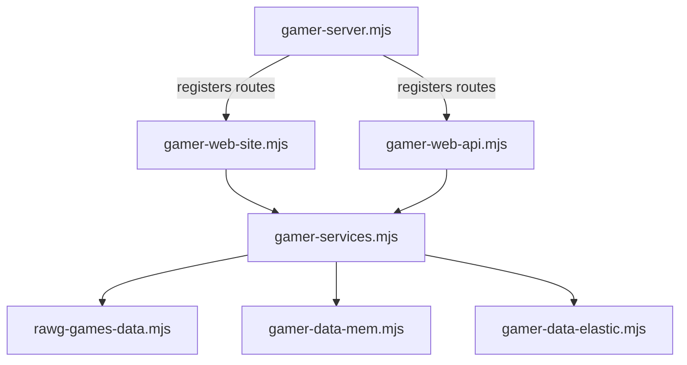

Instituto Superior de Engenharia de Lisboa

Bachelor in Computer Science and Computer Engineering
 Bachelor in Informatics, Networks and Telecommunications Engineering

Web Programming and Architecture
 
Winter Semester of 2026/2027 – <strong>3rd practical assignment - GAMER - Part 2</strong>

---

# Delivery

## **Due date for this assignment: 13/12/2026 - 23h59.**

## **Delivery method**

This assignment continues the GAMER application developed in Part 1. Deliver it
in the same GitHub Classroom repository, by creating a tag called `GAMER-P2`. If
you need to update your delivery, create another tag named `GAMER-P2.1`,
`GAMER-P2.2`, and so on.

The main goals of this part are to provide a browser-based user interface for
the GAMER application and to store GAMER-specific data in a database instead of
memory.

# Functional requirements

1. Add a server-side rendered web interface for all the functionalities provided
   by the Web API:

   - Browse and search the RAWG game catalogue, and view game details.
   - Create a user.
   - Create, edit, list, view and delete the authenticated user's Game Lists.
   - Add games to and remove games from a Game List.

   The interface must use HTML, CSS and Handlebars. Bootstrap may be used for
   styling. The API must continue to return JSON; HTML pages are provided by the
   web interface.

   All operations corresponding to Web API `PUT` and `DELETE` requests, except
   user creation, must be available through HTML forms submitted with `POST`.
   The interface must retain and use the user's token, hardcoded, or statically
   configured (e.g in a configuration file), so that list operations are
   performed as the authenticated user; users must not have to enter their token
   manually.

   **Users must not have to know or enter identifiers** for users, lists or
   games. Use links, buttons and selection controls to identify resources. The
   only free-text game name input is for searching the catalogue; the only
   free-text list name input is when creating or editing a list.

2. The interface must respect the constraints defined in Part 1: a list may
   contain at most 10 games, and a game may not appear more than once in the
   same list. Each list must only be accessible to its owner.

# Non-functional requirements

1. Add a new module named `gamer-web-site.mjs`, at the same level as
   `gamer-web-api.mjs`, to implement the HTML routes and pages. Keep the Web API
   and its JSON responses available.

2. Add a data module named `gamer-data-elastic.mjs` that stores GAMER-specific
   data (users, tokens and Game Lists) in Elasticsearch. Keep
   `gamer-data-mem.mjs`; the application must be configurable to select either
   data implementation from the composition root in `gamer-server.mjs`.

   The new data module must implement the same asynchronous interface as
   `gamer-data-mem.mjs`, so no changes to the services or Web API should be
   needed to switch implementations. Use Node.js's global `fetch` to access
   Elasticsearch's HTTP API; do not use an Elasticsearch-specific Node.js
   client.

3. Configure the Elasticsearch connection and RAWG API key outside the source
   code, for example through environment variables. Do not commit credentials or
   API keys to the repository.

4. Preserve and improve the tests from Part 1:

   - Test the web interface and its form submissions without depending on live
     RAWG or Elasticsearch services.
   - Test the Elasticsearch data module's behavior, including error responses,
     without requiring the external service for unit tests.
   - Keep the existing service tests independent of RAWG and persistent storage
     by using test doubles.

The application modules should have the following dependencies:

`gamer-server.mjs` is the composition root: it selects and creates the data
implementation, injects it and `rawg-games-data.mjs` into `gamer-services.mjs`,
and injects the services into both the Web API and web interface. The services
must not import concrete data implementations.

# Development methodology

1. Implement the user interface using the existing services, initially backed by
   `gamer-data-mem.mjs`.
2. Implement and test the Elasticsearch data module against the same
   asynchronous contract as the in-memory module.
3. Configure the application root to select the data implementation and verify
   that the existing API and the web interface work with both implementations.
4. Update the OpenAPI specification and REST Client requests if the Web API
   changes. Keep the specification and request file at
   `docs/gamer-api-spec.[yaml|json]` and `docs/gamer-api-requests.http`.